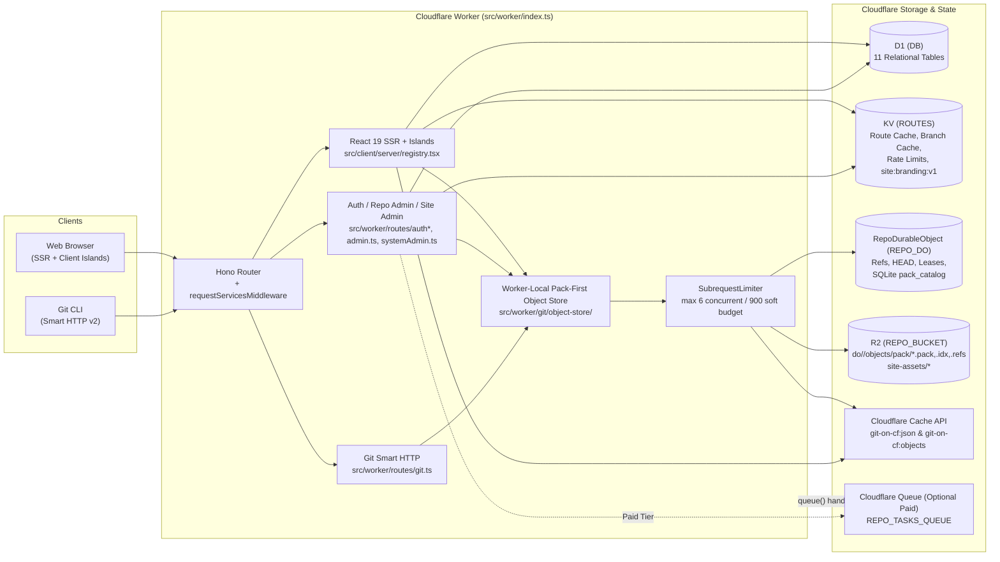
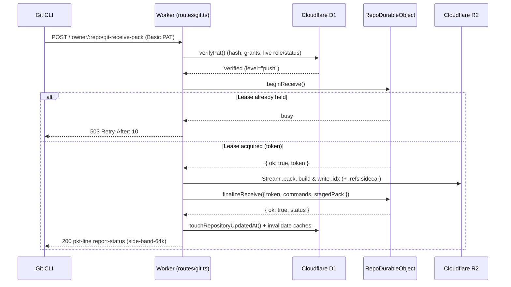

# System Architecture

Gitra is a stateless edge HTTP & Git Smart HTTP v2 application running on **Cloudflare Workers** (`nodejs_als` compatibility flag, compatibility date `2026-05-13`) with strongly consistent per-repository **Durable Objects (`RepoDurableObject`)**, **R2** pack storage, **D1** relational metadata, **KV** caching/settings, and optional **Cloudflare Queues** on the Paid plan.

---

## 1. High-Level Component Topology

---

## 2. Core Architectural Invariants

1. **Single-Hop Boundary Discipline:** Cross-runtime calls stay to a single hop (`Worker → DO`, `Worker → R2`, or `DO → R2` during DO alarm cleanup). Transitive chains such as `Worker → DO → R2` are prohibited—for example, repository deletion enumerates and deletes R2 objects from the Worker/queue handler first, then invokes `stub.clearRepositoryStorage()` for DO-only cleanup (`src/worker/do/repo/repoDO.ts`).
2. **Stateless Worker, Transactional DO:** Workers perform stateless request handling, streaming pack I/O, and rendering. Each repository's `RepoDurableObject` is the strongly consistent authority for `refs`, `HEAD`, active/superseded `pack_catalog` rows, and exclusive receive/compaction leases.
3. **No `blockConcurrencyWhile` in RPCs:** Only the `RepoDurableObject` constructor uses `ctx.blockConcurrencyWhile()` to load `lastAccessMs` and run initial Drizzle SQLite migrations. Runtime RPCs deduplicate lazy schema re-migration via an in-memory promise (`schemaInitPromise`) and communicate conflicts via tagged unions rather than throwing.
4. **Limiter & Subrequest Budget Enforcement (`src/worker/git/operations/limits.ts`):** Request-scoped R2 reads/writes and DO RPCs execute through `SubrequestLimiter` (`MAX_SIMULTANEOUS_CONNECTIONS = 6`, `DEFAULT_SUBREQUEST_BUDGET = 900`) memoized on `CacheContext.memo.limiter`.
5. **Worker Owns All HTML Routing:** `wrangler.jsonc` sets `assets.html_handling: "none"` so Cloudflare Static Assets never shadow dynamic routes like `/auth`, `/admin`, or `/:owner/:repo`.

---

## 3. Route Registration & Middleware Order (`src/worker/index.ts`)

Hono evaluates routes in registration order. The exact order in `src/worker/index.ts` is an invariant to prevent `/:owner` from shadowing system routes:

1. `requestServicesMiddleware` (`src/worker/routes/hono.ts`) — initializes per-request `db` (`createDb(env.DB)` + `ensureD1Schema`), `cacheCtx`, `limiter`, and `logFor()`.
2. `registerGitRoutes(app)` — `/:owner/:repo/info/refs`, `git-upload-pack`, `git-receive-pack`.
3. `registerAdminRoutes(app)` — `/:owner/:repo/admin/*` (refs, head, compact, debug, pack delete, purge).
4. `registerAuthRoutes(app)` — `/auth*`, `/user*`, `/auth/api/*`.
5. `registerSystemAdminRoutes(app)` — `/admin*`, `/admin/api/*`, `/api/site-assets/:slot`, `/favicon.ico`, `/robots.txt`.
6. Top-level pages — `GET /`, `GET /explore`, `GET /namespaces`.
7. `registerUiRoutes(app)` — `/profile/:owner`, `/:owner`, `/:owner/:repo`, `/tree`, `/blob`, `/commits`, `/commit/:oid`, `/raw`, `/rawpath`, `/api/refs`, `/admin`.
8. `app.notFound()` & `app.onError()` — content-negotiated JSON vs SSR error/404 pages (`wantsJsonErrorResponse()`).

---

## 4. Streaming Push (Receive-Pack) Sequence

Web file commits (`PUT /auth/api/repositories/:repositoryId/file` and `profile-readme`) follow the same lease-and-pack commit model via `commitRepositoryFile()` (`src/worker/git/commitFile.ts`).

---

## 5. Streaming Fetch (`git-upload-pack` v2) & Pack-First Reads

- **`ls-refs`**: Reads `HEAD` and refs from `RepoDurableObject` (cached 60s for public repos; bypassed for private repos), optionally peeling annotated tags via `loadPeeledTagTargets()`.
- **`fetch`**:
  1. Parses `want`/`have` pkt-lines; if `done` is absent, returns negotiation acknowledgments (`ACK`/`NAK`) only.
  2. Loads the active pack catalog once per request via `loadActivePackCatalog()` (`src/worker/git/object-store/catalog.ts`), memoized in `CacheContext.memo`.
  3. Computes the object closure (using `.refs` sidecars where available) and streams a packfile directly from R2 range reads (`streamPackFromR2()` for single-pack or `streamPackFromMultiplePacks()` for multi-pack union) with `crypto.DigestStream` incremental SHA-1 trailers over `side-band-64k`.
  4. Returns `503` (`Retry-After: 5`, `X-Git-Error: repository-not-ready`) if the repository has no active packs yet.

---

## 6. Two-Tier Caching & Private-Repo Isolation

- **Workers Cache API (`src/worker/cache/`):**
  - `git-on-cf:json`: Short-TTL UI metadata (`/_cache/refs` 60s, `/_cache/tree` 60s–300s, `/_cache/readme` 300s, `/_cache/commits` 60s–3600s, immutable commit diffs/patches).
  - `git-on-cf:objects`: Immutable Git objects (`/_cache/obj/:repoId/:oid`, 1-year TTL).
- **Private Repository Isolation (`src/worker/cache/policy.ts`):** Whenever a route targets a `private` repository or a mutating Git path (`git-receive-pack`), `markRequestPrivate(cacheCtx)` sets `no-cache-read` and `no-cache-write` flags on `CacheContext.memo.flags`, bypassing all shared Cache API reads/writes and emitting `Cache-Control: no-store`.
- **KV (`ROUTES`):** Holds non-sensitive public route candidate records, branch summary cache records, auth rate-limit windows (`auth-rl:*`), and live site branding (`site:branding:v1`). Private repositories are intentionally omitted from `ROUTES` public route cache entries.

---

## 7. SSR + Client Island Rendering

- Server views are registered in `src/client/server/registry.tsx` and rendered through `renderUiView()` (`src/client/server/render.tsx`) using React 19 `renderToReadableStream()`.
- Every page loads `clientEntrypoints.shell` (global navigation, theme/layout scripts) plus at most one route-specific island entrypoint from `src/client/entrypoints.ts` (e.g., `blobPage`, `commitPage`, `adminSettingsPage`).
- Production assets are mapped via Vite's manifest (`dist/client/manifest.json`) and served through the `ASSETS` binding.

---

## 8. Background Work, Alarms & Free/Paid Dispatch

- **`RepoDurableObject.alarm()` (`src/worker/do/repo/repoDO.ts`):**
  1. Clears expired receive and compaction leases (`clearExpiredLeases`).
  2. Re-arms compaction queue work when `compactionWantedAt` is pending (`rearmCompactionQueueFromAlarm`).
  3. Runs idle cleanup for empty repositories exceeding `REPO_DO_IDLE_MINUTES` (`handleIdleAndMaintenance`).
- **Queue Consumer (`src/worker/tasks/queue.ts#handleRepoTaskQueue`):** Dispatches Zod-validated messages (`compaction`, `compaction-delete`, `pack-ref-backfill`, `route-cache-sync`, `repository-delete`).
- **Free-Tier Fallback (`src/worker/tasks/dispatch.ts`):** When `REPO_TASKS_QUEUE` is absent (`CLOUDFLARE_TIER=free`), `route-cache-sync` runs via `ctx.waitUntil`, `repository-delete` runs inline, and optional maintenance/compaction messages are safely skipped.
