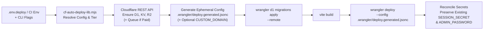

# Building & Packaging

Gitra uses **Vite 8** with **`@cloudflare/vite-plugin`** and **Tailwind CSS v4** (`@tailwindcss/vite`) to produce both the Cloudflare Worker SSR bundle and hashed static client assets in a single `vite build` pipeline.

---

## 1. Build Pipeline (`vite.config.ts`, `package.json`)

```bash
npm run build
```

1. **Client Environment:** Compiles `src/client/entries/styles.ts` and the 13 JavaScript/TypeScript island entrypoints defined in `src/client/entrypoints.ts`, emitting hashed files and `dist/client/manifest.json`.
2. **Worker (SSR) Environment:** Compiles `src/worker/index.ts` (including React 19 SSR pages, Hono routes, `RepoDurableObject`, and Drizzle migrations) for Cloudflare's `workerd` runtime with `import.meta.env.PROD === true`.
3. **Production Auth Mode Lock-In:** Because `import.meta.env.PROD` compiles to `true` in production bundles, `resolveAuthRuntimeMode()` (`src/worker/auth/adminAuth.ts`) automatically disables Demo Mode, hides demo login UI, disables demo repo seeding, and enforces fail-closed `SESSION_SECRET` / `ADMIN_PASSWORD` checks.

---

## 2. Free vs Paid Wrangler Templates

Tracked Wrangler templates are intentionally free of account IDs, D1 UUIDs, KV IDs, R2 bucket names, and custom domains:

| File                      | Target Plan                              | Differences                                                                                                                      |
| :------------------------ | :--------------------------------------- | :------------------------------------------------------------------------------------------------------------------------------- |
| **`wrangler.jsonc`**      | Cloudflare Free (`CLOUDFLARE_TIER=free`) | Declares `ASSETS`, `DB` (D1), `ROUTES` (KV), `REPO_BUCKET` (R2), and `REPO_DO` (SQLite Durable Object). Omits Cloudflare Queues. |
| **`wrangler.paid.jsonc`** | Cloudflare Paid (`CLOUDFLARE_TIER=paid`) | Adds `CLOUDFLARE_TIER: "paid"` plus `queues.producers` and `queues.consumers` bound to `REPO_TASKS_QUEUE`.                       |

Both manifests set `assets.html_handling: "none"` so the Worker owns all HTML routing.

---

## 3. Zero-Touch Auto-Deploy Packaging (`scripts/cf-auto-deploy.mjs`)



- The ephemeral `.wrangler/deploy.generated.jsonc` lives inside `.wrangler/` (gitignored) and is regenerated cleanly on every deploy.
- Secret reconciliation runs against Cloudflare's Worker secrets API so repeat deploys never overwrite `SESSION_SECRET`, `CREDENTIAL_SECRET`, `ADMIN_BOOTSTRAP_SECRET`, or optional `ADMIN_PASSWORD` unless `--rotate-secrets` / `FORCE_ROTATE_SECRETS=true` is explicitly provided.

---

## 4. Packaging & Verification Scripts (`package.json`)

| Script                                   | Command                                                                                                          | Use Case                                                                                                                         |
| :--------------------------------------- | :--------------------------------------------------------------------------------------------------------------- | :------------------------------------------------------------------------------------------------------------------------------- |
| `npm run build`                          | `vite build`                                                                                                     | Build production Free-tier client + Worker bundles                                                                               |
| `npm run build:paid`                     | `WRANGLER_CONFIG=./wrangler.paid.jsonc vite build`                                                               | Build production Paid-tier bundles                                                                                               |
| `npm run typecheck`                      | `npm run types:generate && tsc -p test/tsconfig.json --noEmit`                                                   | Full TypeScript strict type verification                                                                                         |
| `npm run cf:auto-deploy`                 | `node scripts/cf-auto-deploy.mjs`                                                                                | Zero-touch idempotent deploy (supports `--free`, `--paid`, `--dry-run`, `--no-queues`, `--domain`, `--name`, `--rotate-secrets`) |
| `npm run cf:auto-deploy:paid`            | `node scripts/cf-auto-deploy.mjs --paid`                                                                         | Zero-touch Paid-tier deploy (`cpu_ms: 300000` + Queues)                                                                          |
| `npm run deploy` _(alias `deploy:free`)_ | `npm run db:migrate && npm run build && wrangler deploy`                                                         | Manual Free-tier Wrangler deploy                                                                                                 |
| `npm run deploy:paid`                    | `wrangler d1 migrations apply DB --remote --config wrangler.paid.jsonc && npm run build:paid && wrangler deploy` | Manual Paid-tier Wrangler deploy                                                                                                 |
| `npm run cf:setup` / `cf:setup:paid`     | `node scripts/cloudflare-setup.mjs`                                                                              | Manual step-by-step Wrangler resource provisioning                                                                               |
