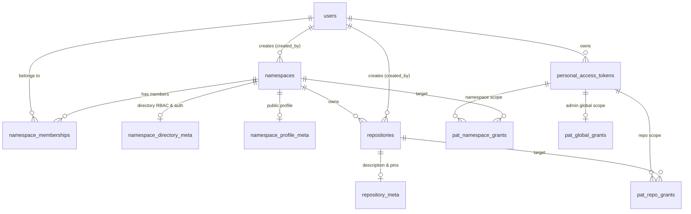

# Database & Storage Schema

Gitra splits state cleanly across four Cloudflare storage primitives so relational queries, per-repository strong consistency, edge caching, and large binary packs each use the optimal backing store.

---

## 1. Cloudflare D1 Relational Schema (`DB` Binding)

Defined in `src/worker/db/d1/schema/*.ts`, migrated via `drizzle/d1/` (`drizzle-d1.config.ts`), and bootstrapped once per isolate for empty local/preview databases by `ensureD1Schema()` (`src/worker/db/d1/bootstrap.ts`).

### Entity-Relationship Diagram

### Complete Table Reference (11 Application Tables)

| Table                          | Primary Key               | Columns                                                                                                                                                                                      | Constraints & Indexes                                                                                                                                                                                 |
| :----------------------------- | :------------------------ | :------------------------------------------------------------------------------------------------------------------------------------------------------------------------------------------- | :---------------------------------------------------------------------------------------------------------------------------------------------------------------------------------------------------- |
| **`users`**                    | `id` (`text`)             | `id`, `tessera_sub` (`text`), `created_at` (`integer`)                                                                                                                                       | `UNIQUE (tessera_sub)` — stores `local:<username>` subject identifier                                                                                                                                 |
| **`namespaces`**               | `id` (`text`)             | `id`, `slug` (`text`), `created_by` (`text`), `created_at` (`integer`)                                                                                                                       | `UNIQUE (slug)`, `FK (created_by) -> users(id) ON DELETE RESTRICT`                                                                                                                                    |
| **`namespace_memberships`**    | `(namespace_id, user_id)` | `namespace_id`, `user_id`, `created_at` (`integer`)                                                                                                                                          | `IDX (user_id, namespace_id)`, `ON DELETE CASCADE` on both FKs                                                                                                                                        |
| **`namespace_directory_meta`** | `namespace_id` (`text`)   | `namespace_id`, `display_name` (default `''`), `role` (default `'member'`), `status` (default `'active'`), `password_hash` (nullable), `last_active_at` (nullable), `updated_at` (`integer`) | `CHECK (role IN ('admin','member','viewer'))`, `CHECK (status IN ('active','disabled'))`, `FK -> namespaces(id) ON DELETE CASCADE`                                                                    |
| **`namespace_profile_meta`**   | `namespace_id` (`text`)   | `namespace_id`, `bio` (default `''`), `location` (default `''`), `website` (default `''`), `updated_at` (`integer`)                                                                          | `FK -> namespaces(id) ON DELETE CASCADE`                                                                                                                                                              |
| **`repositories`**             | `id` (`text`)             | `id`, `namespace_id`, `created_by`, `slug`, `do_name`, `visibility`, `created_at`, `updated_at`                                                                                              | `CHECK (visibility IN ('public','private'))`, `UNIQUE (namespace_id, slug)`, `UNIQUE (do_name)`, `IDX (namespace_id, updated_at DESC, slug)`, `FK (namespace_id) CASCADE`, `FK (created_by) RESTRICT` |
| **`repository_meta`**          | `repository_id` (`text`)  | `repository_id`, `description` (default `''`), `pinned` (`integer` default `0`), `home_pinned` (`integer` default `0`), `updated_at` (`integer`)                                             | `FK -> repositories(id) ON DELETE CASCADE`                                                                                                                                                            |
| **`personal_access_tokens`**   | `id` (`text`)             | `id`, `user_id`, `name`, `prefix`, `hash`, `created_at`, `expires_at` (nullable), `revoked_at` (nullable), `last_used_at` (nullable)                                                         | `UNIQUE (prefix)`, `IDX (user_id, created_at DESC)`, `FK -> users(id) ON DELETE CASCADE`                                                                                                              |
| **`pat_namespace_grants`**     | `(pat_id, namespace_id)`  | `pat_id`, `namespace_id`, `level`                                                                                                                                                            | `CHECK (level IN ('pull','push'))`, `IDX (namespace_id)`, `ON DELETE CASCADE`                                                                                                                         |
| **`pat_repo_grants`**          | `(pat_id, repo_id)`       | `pat_id`, `repo_id`, `level`                                                                                                                                                                 | `CHECK (level IN ('pull','push'))`, `IDX (repo_id)`, `ON DELETE CASCADE`                                                                                                                              |
| **`pat_global_grants`**        | `pat_id` (`text`)         | `pat_id`, `level`, `created_at`                                                                                                                                                              | `CHECK (level IN ('pull','push'))`, `FK -> personal_access_tokens(id) ON DELETE CASCADE`                                                                                                              |

_(Wrangler also maintains the `d1_migrations` bookkeeping table; `ensureD1Schema()` seeds entries for `0000_gray_supernaut.sql` and `0001_outgoing_vin_gonzales.sql` so formal `wrangler d1 migrations apply` stays idempotent.)_

---

## 2. `RepoDurableObject` Storage (`REPO_DO` Binding)

Each repository maps to a dedicated Durable Object instance keyed by `repositories.do_name`.

### Embedded SQLite Table (`src/worker/do/repo/db/schema.ts`)

Managed via `drizzle-orm/durable-sqlite` (`drizzle-repo-do.config.ts` → `drizzle/repo-do/`). All queries must pass through `src/worker/do/repo/db/dal/`.

| Table              | Primary Key         | Columns                                                                                                                                                                                                      | Indexes & Checks                                                                                                                                                                                                                       |
| :----------------- | :------------------ | :----------------------------------------------------------------------------------------------------------------------------------------------------------------------------------------------------------- | :------------------------------------------------------------------------------------------------------------------------------------------------------------------------------------------------------------------------------------- |
| **`pack_catalog`** | `pack_key` (`text`) | `pack_key`, `kind`, `state`, `tier` (`int`), `seq_lo` (`int`), `seq_hi` (`int`), `object_count` (`int`), `pack_bytes` (`int`), `idx_bytes` (`int`), `created_at` (`int`), `superseded_by` (`text`, nullable) | `IDX (state, seq_hi DESC)`, `IDX (state, tier, seq_lo)`, `CHECK (kind IN ('receive','compact','legacy'))`, `CHECK (state IN ('active','superseded'))`, `CHECK (tier >= 0)`, `CHECK (seq_lo <= seq_hi)`, non-negative count/byte checks |

### DO Key-Value Storage Entries (`src/worker/do/repo/`)

- `refs`: array of `{ name: string; oid: string }`
- `head`: `{ target: string; oid?: string; unborn?: boolean }`
- `receiveLease`, `compactLease`: exclusive writer/compaction lease tokens & expiry timestamps
- `compactionWantedAt`, `lastAccessMs`: maintenance & idle-cleanup scheduling timestamps

---

## 3. Cloudflare R2 Object Layout (`REPO_BUCKET` Binding)

Centralized in `src/worker/keys.ts` and `src/worker/branding.ts`:

| Prefix / Key Pattern                 | Purpose                                                              |
| :----------------------------------- | :------------------------------------------------------------------- |
| `do/<doId>/objects/pack/<name>.pack` | Git packfile data (accessed via range reads on fetch)                |
| `do/<doId>/objects/pack/<name>.idx`  | Git pack v2 index (authoritative for OID membership & byte offsets)  |
| `do/<doId>/objects/pack/<name>.refs` | Logical object-reference sidecar accelerating fetch closure planning |
| `do/<doId>/objects/loose/<oid>`      | Legacy helper key path (`r2LooseKey`); active writes are pack-only   |
| `site-assets/logo`                   | Uploaded site logo image (≤ 512 KiB)                                 |
| `site-assets/favicon`                | Uploaded site favicon image (≤ 512 KiB)                              |
| `site-assets/og-image`               | Uploaded OpenGraph social share image (≤ 2 MiB)                      |

---

## 4. Cloudflare KV Key Namespaces (`ROUTES` Binding)

| Key Pattern                                                       | Purpose                                                                                    |
| :---------------------------------------------------------------- | :----------------------------------------------------------------------------------------- |
| Public route cache keys (`src/worker/repositories/routeCache.ts`) | Non-sensitive public repository route candidates (private repos excluded)                  |
| Branch summary cache keys (`deleteRepoBranchCacheRecord`)         | Cached default/branch metadata invalidated on push or ref/HEAD mutation                    |
| `auth-rl:<scope>:<ip>:<target>` (`src/worker/auth/rateLimit.ts`)  | Sliding failure window (`maxFailures = 8`, `TTL = 300s`) for `login` and `change-password` |
| `site:branding:v1` (`src/worker/branding.ts`)                     | Live JSON overrides for site branding, SEO metadata, asset URLs, and `allowIndexing`       |
