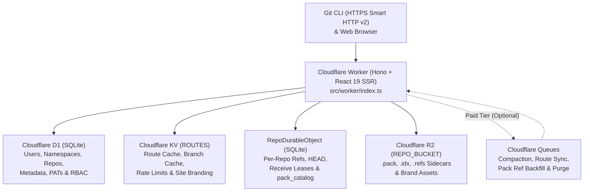

# Gitra Documentation

**Gitra** (`https://gitra.co/`) is an open-source, serverless Git hosting platform built on **Cloudflare Workers**, **Durable Objects (SQLite)**, **R2**, **D1**, and **KV**, maintained by **[Vib Tools](https://vib.tools/)** (`@vibtoolshq`).

This documentation suite is generated directly from a forensic audit of the live codebase and serves as the authoritative guide for end users, self-hosters, and contributors.

> **Package Identifier Note:** The project brand and documentation use **Gitra** (`gitra.co`), while internal package metadata (`package.json`, default `wrangler.jsonc` worker name, Git agent string `agent=git-on-cloudflare/0.1`, and several legacy title/cookie prefixes such as `goc_`) retain `git-on-cloudflare` identifiers for backward compatibility.

---

## Documentation Pathways

| Audience                     | Start Here                                           | What You Will Find                                                                                      |
| :--------------------------- | :--------------------------------------------------- | :------------------------------------------------------------------------------------------------------ |
| **Developers & End Users**   | [User Guide](./users/index.md)                       | Getting started, Git CLI workflows, web code browser, `.vibtools` profiles, tokens, and troubleshooting |
| **Self-Hosters & Operators** | [Installation & Deployment](./users/installation.md) | Zero-touch Cloudflare Free & Paid auto-deploy, custom domains, branding studio, and security policies   |
| **Platform Contributors**    | [Developer Guide](./dev/index.md)                    | System architecture, Hono/SSR/DO internals, exhaustive API contracts, D1 & DO schemas, and testing      |
| **Quick Lookup**             | [Technical Reference](./dev/reference/index.md)      | All environment variables, Wrangler bindings, CLI flags, audited dependencies, and glossary             |
| **Audit & Inventory**        | [Documentation Manifest](./MANIFEST.md)              | Complete file map, feature maturity matrix, reconciliation log, and verification summary                |

---

## System Architecture at a Glance

---

## Key Guides

### User & Operator Guides

- [Getting Started](./users/getting-started.md) — Explore Demo Mode locally, sign in, create a repository, and push your first commit.
- [Installation & Zero-Touch Auto-Deploy](./users/installation.md) — Deploy to Cloudflare Free or Paid accounts with automatic resource provisioning.
- [Configuration & Live Branding](./users/configuration.md) — Configure `.dev.vars`, `.env.deploy`, Worker secrets, and `/admin/settings`.
- [Feature Guides](./users/features/index.md) — Deep dives into Git CLI, Code Browser, Namespaces, RBAC/PATs, Admin Console, and Cloudflare Tiers.
- [Common Workflows](./users/workflows.md) — Step-by-step developer and administrator playbooks.
- [Troubleshooting](./users/troubleshooting.md) & [FAQ](./users/faq.md) — Diagnosing verified HTTP/Git errors and platform limits.

### Developer & Architecture Guides

- [Architecture Overview](./dev/architecture.md) — Runtime topology, single-hop boundary rules, streaming push/fetch, and caching.
- [Codebase Structure](./dev/codebase-structure.md) — Complete source tree map across `src/worker/`, `src/client/`, `src/shared/`, and `scripts/`.
- [Local Development Setup](./dev/local-setup.md) — Running Vite + Cloudflare plugin locally, Drizzle migrations, and typegen.
- [HTTP & JSON API Reference](./dev/api-reference.md) — Every Git, Web UI, Auth, Repo Admin, and Site Admin route verified from source.
- [Database Schema](./dev/database-schema.md) — All 11 D1 tables, Repo DO `pack_catalog`, and migration workflows.
- [Security Architecture](./dev/security.md) — Cryptography, cookie sealing, CSRF checks, PAT verification, and rate limiting.
- [Building & Packaging](./dev/building-packaging.md) — Vite SSR/client bundles, Free vs Paid configs, and CI/CD.
- [Testing Guide](./dev/testing.md) — Node unit tests, Cloudflare Worker pool tests, and fixture testing.
- [Contributing](./dev/contributing.md) — Architectural invariants and validation checklists.

### Legacy & Deep-Dive Notes

- [Cloudflare Deployment Quickstart](./CLOUDFLARE_DEPLOY.md)
- [Storage Model Summary](./storage.md)
- [Data Flows Summary](./data-flows.md)
- [Caching Strategy](./caching.md)

---

## Project & Maintainer Information

- **Official Website:** [https://gitra.co/](https://gitra.co/)
- **Source Repository:** [https://github.com/vibtoolshq/gitra](https://github.com/vibtoolshq/gitra)
- **Maintainer:** [Vib Tools](https://vib.tools/) (`@vibtoolshq`)
- **Support & Contact:** `support@vibtools.io` · `hello@vibtools.io`
- **License:** MIT (`Copyright (c) 2026 Vib Tools`)
